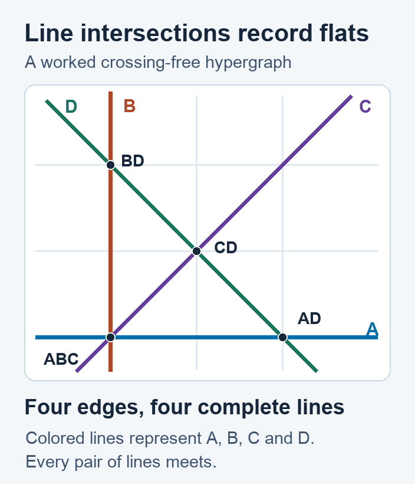

# Crossing-free line representations of hypergraphs

  

Recognizing a crossing-free representation by complete affine lines is ∃ℝ-complete even for linear hypergraphs in which every two edges intersect. Here a crossing is allowed precisely at a shared vertex. The classification follows from Kim, de Mesmay and Miltzow’s real rank-three matroid theorem and the standard intersection-lattice correspondence.

[Read the paper](paper/manuscript.pdf) · [LaTeX source](paper/manuscript.tex) · [Proof outline](proof/PROBLEM_AND_PROOF.md) · [Run the replay](REPRODUCIBILITY.md)

## Where four lines meet

A, B and C meet at the shared vertex (0, 0). Each also meets D at a separate vertex, so four vertices record all six line pairs. Erase AD from this drawing and A and D still cross at (2, 0). The drawing then fails the crossing-free rule.

[Download the offline explorer](https://raw.githubusercontent.com/DannyExperiments/crossing-free-hypergraph-lines/refs/tags/v1.0.0/visualization/line-incidences-explorer.zip), extract it and open `index.html` to inspect any line pair or erase its shared vertex. [Figure guide](visualization/README.md)

## Sources and verification

[Dobler’s thesis §5.6](https://doi.org/10.34726/hss.2026.139471) and [Dobler, Kobourov, Mondal and Nöllenburg §7](https://arxiv.org/html/2411.13985v4#S7) ask the recognition question recorded as [catalog Q233](https://github.com/10m-u/open-problems-catalog/blob/ca8d4d44ba3db527f19f28928c240168f545ecfe/problems/computer_science_ai/theory-of-computation-algorithms-part-1.md#q233). The replay checks exact point-line incidences, all pairwise intersections and reconstructed independent triples on 202 rank-three configurations.

[Mathematical audit](audits/public_safe_reports/MATHEMATICAL_AUDIT.md) · [Literature audit](audits/public_safe_reports/LITERATURE_AUDIT.md) · [Scope](CLAIM_SCOPE_AND_LIMITATIONS.md) · [AI disclosure](AI_DISCLOSURE.md) · [Status](STATUS.md)

[Release v1.0.0](https://github.com/DannyExperiments/crossing-free-hypergraph-lines/releases/tag/v1.0.0) · [Version DOI](https://doi.org/10.5281/zenodo.24569558) · [Citation](CITATION.cff)
